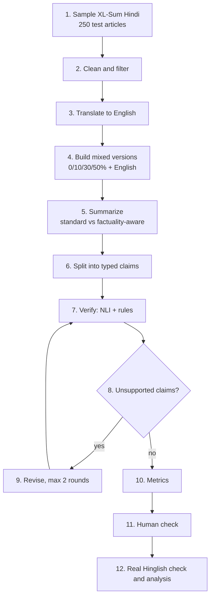

# FactIndic

**Factuality-aware summarization for Hindi-English code-mixed text.**
Course project for CSET 346 (Natural Language Processing), Bennett University. Team 8.

> Status: planning and scaffolding. The pipeline scripts are stubs and no results exist yet. See [Roadmap](#roadmap).

## Contents
1. [Overview](#overview)
2. [Research questions](#research-questions)
3. [What is new](#what-is-new)
4. [Pipeline](#pipeline)
5. [Data](#data)
6. [Evaluation](#evaluation)
7. [Repository layout](#repository-layout)
8. [Getting started](#getting-started)
9. [Team and workflow](#team-and-workflow)
10. [Results](#results)
11. [Roadmap](#roadmap)
12. [Limitations](#limitations)
13. [References](#references)

## Overview
LLMs summarize Hindi text fluently, but a fluent summary can still change a number, swap a name, or add a claim the
article never made. Most Indian-language text online is code-mixed, with English words inside Hindi sentences, for example:

> भारत में pollution का level लगातार increase हो रहा है।

We study how this mixing affects the **factual consistency** of LLM summaries. We take Hindi news articles, create
versions with controlled amounts of English (0, 10, 30, 50% and a full English translation), summarize each version,
check every summary claim against its source, and test whether prompting and a verify-and-revise loop reduce the errors.

Factual consistency here means **supported by the input article**, not true in the real world.

## Research questions
| | Question |
|---|---|
| RQ1 | How does factual consistency change as the input moves from Hindi (0% English) through 10, 30 and 50% mixing to English? |
| RQ2 | Does a factuality-aware prompt beat a standard prompt, and does it help more on mixed input? |
| RQ3 | Does a generate, verify, revise loop reduce unsupported claims further? |
| RQ4 | Which information types (numbers, dates, entities, relations) are distorted most, and does that change with mixing level? |
| RQ5 | Do findings on synthetic code-mixed text hold on real Hinglish text? |

## What is new
We do not propose a new model. The contribution is an experiment, built as an extension of earlier Hinglish
summarization work such as MedSumm, which used one fixed mixing level, human-only factuality checks, and no mitigation.
To the best of our knowledge (the literature search is still limited), we add:

1. **A controlled mixing curve with baselines**: 0, 10, 30, 50% English plus a full English version of the same article.
2. **Automatic claim-level factuality checks**, validated against human labels with Cohen's kappa for each mixing level.
3. **Training-free mitigation**: a factuality-aware prompt and a revise loop.
4. **A key-fact-weighted score** in which numbers, dates and names count more. This depends on an overlap check with
   related work on entity hallucination, so it is not yet claimed as new.

## Pipeline


| Script | Steps | What it does | Owner |
|---|---|---|---|
| `01_sample_clean.py` | 1-2 | Sample 250 XL-Sum Hindi test articles, clean them | B |
| `02_translate.py` | 3 | English translation of each article and reference | B |
| `03_make_versions.py` | 4 | 10/30/50% mixed versions with script checks | B |
| `04_summarize.py` | 5 | Standard vs factuality-aware summaries, cached | C |
| `05_verify.py` | 6-8 | Typed claims, NLI plus rules, key facts, scores | A |
| `06_revise.py` | 9 | Revise loop, max 2 rounds, then re-verify | C + A |
| `07_metrics.py` | 10 | ROUGE, BERTScore, length, compression, time | D |
| `08_human_labels.py` | 11 | Label sheet, human-vs-human kappa | D |
| `09_real_hinglish.py` | 12 | MUTANT and GupShup side check | B, C, A, D |
| `10_analysis.py` | 12 | Plots, bootstrap intervals, tables | D |

### Handoffs
`versions.jsonl` (B to C) → `summaries.jsonl` (C to A) → `verdicts.jsonl` (A to D). C and A also loop on flagged
claims during revision. Field-by-field formats are in [`docs/schemas.md`](docs/schemas.md).

## Data
Datasets are **not committed** to this repository. Download them locally, and check each license before use.

| Role | Dataset | Notes |
|---|---|---|
| Main source (Hindi) | XL-Sum Hindi | BBC news with reference summaries; 88,472 articles in the release table; we sample 250 test articles |
| English control | XL-Sum English | Different articles from the Hindi ones, not a translation |
| Real mixed news-style text | MUTANT | 67k articles with 85k identified Hinglish spans; script and reference summaries still to check |
| Real mixed summaries | GupShup | 6,831 Hindi-English conversations with human summaries; script still to check |
| Mixing statistics | PHINC, HinGE, GLUECoS English-Hindi | Used for the realism check |
| Verifier fine-tuning | IndicXNLI (Hindi), XNLI or MNLI (English) | IndicXNLI is machine-translated XNLI |

## Evaluation
- **Hallucination rate** = unsupported claims ÷ all summary claims.
- **Factual recall** = key article facts covered by the summary ÷ all key facts (key facts are extracted from the input article, not the reference).
- **Weighted key-fact score**: facts with numbers, dates or names weigh 2, others 1, minus 1 per unsupported critical claim; sensitivity runs with weights 1 and 3.
- **ROUGE-1/2/L and BERTScore** against references transformed the same way as the article.
- **Length, compression ratio** (summary words ÷ article words), and **inference time**.
- **Verifier agreement**: percentage agreement and Cohen's kappa against human labels, reported per mixing level.
- Intervals come from a bootstrap that resamples by article.

## Repository layout
```
configs/        config.yaml: every setting in one place
data/           local data, not in Git; example rows only
docs/           schemas.md (handoff formats), labeling_guide.md
src/factindic/  data, mixing, llm, verify, metrics, analysis
scripts/        numbered entry points, one per pipeline step
app/            Streamlit demo (paste text, see summary and factuality)
results/        tables/ and figures/ (committed)
paper/ slides/  deliverables
```

## Getting started
Requires Python 3.10 or newer.

```bash
python -m venv .venv
source .venv/bin/activate        # Windows PowerShell: .venv\Scripts\Activate.ps1
pip install -r requirements.txt
cp .env.example .env             # Windows: copy .env.example .env   (then add your keys; never commit .env)
```

All settings (seed, sample size, mixing levels, thresholds, model names) live in `configs/config.yaml`.
Model names are `TBD` until the model pilot is done.

### Try the demo
The demo has its own requirements file and currently calls the Anthropic API from `app/llm.py`.
To use another provider, change the `_call` function there.

```bash
cd app
pip install -r requirements.txt
# See the interface without any API key or model (results are fake in this mode):
FACTINDIC_MOCK=1 streamlit run app.py      # PowerShell: $env:FACTINDIC_MOCK="1"; streamlit run app.py
```

### Run the pipeline
The scripts are stubs, so this will work once each owner has implemented their step. Run them in numeric order:
```bash
python scripts/01_sample_clean.py
python scripts/02_translate.py
# ... through 10_analysis.py
```

## Team and workflow
Team 8. Names to add:

| Role | Responsibility | Person |
|---|---|---|
| A | Verification and metrics (claims, NLI, rules, scores) | |
| B | Data and mixed versions (sampling, translation, generator) | |
| C | LLM runs and mitigation (prompts, summaries, revise loop) | |
| D | Accuracy checks, standard metrics and assembly | |

Branches, reviews, ownership of folders and the "never commit" rules are in [`CONTRIBUTING.md`](CONTRIBUTING.md).

**Reproducibility.** Fixed seed, every setting in the config, exact model names, versions and dates recorded in
`summaries.jsonl`, and every LLM call cached so nothing is paid for twice.

## Results
No results yet. This table will be filled from `results/tables/metrics.csv`.

| Version | Prompt | Hallucination rate | Factual recall | Weighted score |
|---|---|---|---|---|
| 0% (Hindi) | standard | | | |
| 0% (Hindi) | factual | | | |
| 30% mixed | standard | | | |
| 30% mixed | factual | | | |
| 100% (English) | standard | | | |
| 100% (English) | factual | | | |

## Roadmap
- [ ] Phase 0: repo, file formats, labeling guide, model pilot, API budget plan
- [ ] Phase 1: sampling and cleaning, translation, mixing generator, prompts and runner, verifier, metrics code
- [ ] Phase 2: 100-article pilot end to end, with spot-checks at every handoff
- [ ] Phase 3: full runs (about 2,500 summaries) and the revise loop
- [ ] Phase 4: human check (150 to 200 claims, everyone labels)
- [ ] Phase 5: real Hinglish check (about 100 inputs)
- [ ] Phase 6: analysis, paper (IEEE, Word and PDF), slides

## Limitations
- The mixed text is synthetic. We compare it with real Hinglish, but it may not look fully natural.
- Verifiers can be weak on code-mixed text: GLUECoS reports a best accuracy of 63.1% on its code-mixed NLI task.
- The English side is machine translation, which can introduce errors. We check numbers and names by script.
- XL-Sum reference summaries are imperfect, so factuality is measured against the article.
- Claim splitting and key-fact extraction are done by an LLM and can drop or rewrite facts.
- Free-tier API limits and retired models may force a smaller sample.
- About 250 articles can reliably show differences of roughly 8 to 10 percentage points, so small effects may be inconclusive.

## References
Details were read from abstracts or dataset cards unless noted. Verify each against the original paper before citing.
1. Pratapa et al. (2018). *Language Modeling for Code-Mixing: The Role of Linguistic Theory based Synthetic Data.* ACL.
2. Gupta et al. (2023). *MUTANT: A Multi-sentential Code-mixed Hinglish Dataset.* Findings of EACL.
3. Srivastava and Singh (2020). *PHINC: A Parallel Hinglish Social Media Code-Mixed Corpus for Machine Translation.* WNUT.
4. Kunchukuttan et al. (2018). *The IIT Bombay English-Hindi Parallel Corpus.* LREC.
5. Aharoni et al. *Multilingual Summarization with Factual Consistency Evaluation (mFACE).*

