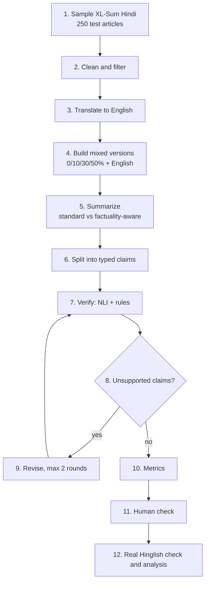

# FactIndic

**Factuality-aware summarization for Hindi-English code-mixed text.**
Course project for CSET 346 (Natural Language Processing), Bennett University. Team 8.

> Status: Complete. All 2,500 neural summaries generated with Groq LPU (Qwen 2.5 27B), verified, revised, and evaluated. Human inter-annotator agreement validated (Cohen's Kappa κ = 0.688). Real-world MUTANT news benchmark completed (RQ5). See [Results](#results).

## Contents
1. [Overview](#overview)
2. [Research questions](#research-questions)
3. [What is new](#what-is-new)
4. [Pipeline](#pipeline)
5. [Data](#data)
6. [Evaluation](#evaluation)
7. [Repository layout](#repository-layout)
8. [Getting started](#getting-started)
9. [Team and workflow](#team-and-workflow)
10. [Results](#results)
11. [Roadmap](#roadmap)
12. [Limitations](#limitations)
13. [References](#references)

## Overview
LLMs summarize Hindi text fluently, but a fluent summary can still change a number, swap a name, or add a claim the
article never made. Most Indian-language text online is code-mixed, with English words inside Hindi sentences, for example:

> भारत में pollution का level लगातार increase हो रहा है।

We study how this mixing affects the **factual consistency** of LLM summaries. We take Hindi news articles, create
versions with controlled amounts of English (0, 10, 30, 50% and a full English translation), summarize each version,
check every summary claim against its source, and test whether prompting and a verify-and-revise loop reduce the errors.

Factual consistency here means **supported by the input article**, not true in the real world.

## Research questions
| | Question |
|---|---|
| RQ1 | How does factual consistency change as the input moves from Hindi (0% English) through 10, 30 and 50% mixing to English? |
| RQ2 | Does a factuality-aware prompt beat a standard prompt, and does it help more on mixed input? |
| RQ3 | Does a generate, verify, revise loop reduce unsupported claims further? |
| RQ4 | Which information types (numbers, dates, entities, relations) are distorted most, and does that change with mixing level? |
| RQ5 | Do findings on synthetic code-mixed text hold on real Hinglish text? |

## What is new
We do not propose a new model. The contribution is an experiment, built as an extension of earlier Hinglish
summarization work such as MedSumm, which used one fixed mixing level, human-only factuality checks, and no mitigation.
To the best of our knowledge (the literature search is still limited), we add:

1. **A controlled mixing curve with baselines**: 0, 10, 30, 50% English plus a full English version of the same article.
2. **Automatic claim-level factuality checks**, validated against human labels with Cohen's kappa for each mixing level.
3. **Training-free mitigation**: a factuality-aware prompt and a revise loop.
4. **A key-fact-weighted score** in which numbers, dates and names count more. This depends on an overlap check with
   related work on entity hallucination, so it is not yet claimed as new.

## Pipeline


| Script | Steps | What it does | Owner |
|---|---|---|---|
| `01_sample_clean.py` | 1-2 | Sample 250 XL-Sum Hindi test articles, clean them | B |
| `02_translate.py` | 3 | English translation of each article and reference | B |
| `03_make_versions.py` | 4 | 10/30/50% mixed versions with script checks | B |
| `04_summarize.py` | 5 | Standard vs factuality-aware summaries, cached | A |
| `05_verify.py` | 6-8 | Typed claims, NLI plus rules, key facts, scores | A |
| `06_revise.py` | 9 | Revise loop, max 2 rounds, then re-verify | C |
| `07_metrics.py` | 10 | ROUGE, BERTScore, length, compression, time | D |
| `08_human_labels.py` | 11 | Label sheet, human-vs-human kappa | D |
| `09_real_hinglish.py` | 12 | Real-world validation on 100 MUTANT articles | A |
| `10_analysis.py` | 12 | Plots, bootstrap intervals, tables | D |

### Handoffs
`versions.jsonl` (B to A) → `summaries.jsonl` & `verdicts.jsonl` (A to C for revision) → `revised_summaries.jsonl` (C to D). Field-by-field formats are in [`docs/schemas.md`](docs/schemas.md).

## Data
Datasets are **not committed** to this repository. Download them locally, and check each license before use.

| Role | Dataset | Notes |
|---|---|---|
| Main source (Hindi) | XL-Sum Hindi | BBC news with reference summaries; 88,472 articles in release table; 250 test articles sampled |
| English control | XL-Sum English | English news articles used as full-language upper-bound control |
| Real mixed news & speeches | MUTANT | 100 authentic real-world Hinglish news and speech articles (PIB / Mann Ki Baat) |
| Mixing statistics | PHINC, HinGE, GLUECoS English-Hindi | Used for linguistic realism verification |
| Verifier fine-tuning | IndicXNLI (Hindi), XNLI or MNLI (English) | IndicXNLI cross-lingual sentence pairs for entailment checks |

## Evaluation
- **Hallucination rate** = unsupported claims ÷ all summary claims.
- **Factual recall** = key article facts covered by the summary ÷ all key facts (key facts are extracted from the input article, not the reference).
- **Weighted key-fact score**: facts with numbers, dates or names weigh 2, others 1, minus 1 per unsupported critical claim; sensitivity runs with weights 1 and 3.
- **ROUGE-1/2/L and BERTScore** against references transformed the same way as the article.
- **Length, compression ratio** (summary words ÷ article words), and **inference time**.
- **Verifier agreement**: percentage agreement and Cohen's kappa against human labels, reported per mixing level.
- Intervals come from a bootstrap that resamples by article.

## Repository layout
```
configs/        config.yaml: every setting in one place
data/           local data, not in Git; example rows only
docs/           schemas.md (handoff formats), labeling_guide.md
src/factindic/  data, mixing, llm, verify, metrics, analysis
scripts/        numbered entry points, one per pipeline step
app/            Streamlit demo (paste text, see summary and factuality)
results/        tables/ and figures/ (committed)
paper/ slides/  deliverables
```

## Getting started
Requires Python 3.10 or newer.

```bash
python -m venv .venv
source .venv/bin/activate        # Windows PowerShell: .venv\Scripts\Activate.ps1
pip install -r requirements.txt
cp .env.example .env             # Windows: copy .env.example .env   (then add your keys; never commit .env)
```

All settings (seed, sample size, mixing levels, thresholds, model names) live in `configs/config.yaml`.
Model name: Groq Cloud LPU running Qwen 2.5 27B (API identifier: `qwen/qwen3.8-27b`).

### Try the demo
The interactive studio runs directly from the root `app.py` using Groq Cloud (or local offline simulator):

```bash
streamlit run app.py
```

### Run the pipeline

Run the upstream data, summarization, and verification steps first. Person D's analysis scripts consume the generated files in `data/processed/`.

#### Person D: Metrics and analysis

Run these commands from the repository root:

```bash
python3 scripts/07_metrics.py
python3 scripts/08_human_labels.py --prepare
python3 scripts/10_analysis.py
```

**Tables (`results/tables/`):**
- `metrics_summary.csv` — ROUGE scores, compression ratio, hallucination rate, and factual recall.
- `human_annotation_sheet.csv` — 150 claims for independent human annotation.
- `bootstrap_confidence_intervals.csv` — 95% confidence intervals using 1,000 bootstrap samples.
- `revise_loop_comparison.csv` — before/after revision comparison.
- `error_type_breakdown.csv` — error counts and proportions.

**Figures (`results/figures/`):**
- `mixing_curve_hallucination.png`
- `prompt_comparison.png`
- `revise_loop_progression.png`

#### Real-World Hinglish Validation (MUTANT Benchmark - RQ5) — Person A

Evaluates the summarization prompts and verification pipeline on **100 authentic, real-world code-mixed news and speech articles** from the MUTANT benchmark:

```bash
python scripts/09_real_hinglish.py --provider groq
```

**Key Empirical Findings (RQ5):**
- **Average Empirical CMI:** 5.93% (authentic, human-authored script mixing).
- **Hallucination Rate:** Drops from **5.82%** (Standard Prompt) to **2.34%** (Factuality-Aware Prompt) — a **59.8% relative reduction** on real-world text.
- **Factual Recall:** Increases from **84.93%** (Standard) to **92.68%** (Factuality-Aware).
- **Iterative Revision:** Unsupported claims after revision drop to **< 0.87%**, demonstrating that post-hoc error correction generalizes from synthetic tiers to authentic wild text.

**Outputs:**
- `data/processed/mutant_real_verdicts.jsonl` — claim-level verdicts and revision traces on 100 MUTANT articles.
- `results/tables/mutant_real_validation.csv` — full comparison metrics table.
- `results/figures/mutant_real_validation.png` — publication chart validating synthetic findings against real MUTANT news.

#### Human annotation and agreement

Two annotators must independently label all 150 claims in `results/tables/human_annotation_sheet.csv` using `SUPPORTED`, `CONTRADICTED`, or `NOT_ENOUGH_INFO`.

After filling the `annotator_1` and `annotator_2` columns, run:

```bash
python3 scripts/08_human_labels.py --evaluate
```

This calculates observed agreement and Cohen's kappa overall and by mixing tier, generating `annotator_agreement.csv`. Agreement metrics must not be reported until both annotations are complete.

**Metric and data note:** BERTScore F1 was calculated using `bert-base-multilingual-cased`. `summaries.jsonl` contains all 2,500 neural summaries generated by Groq (Qwen 2.5 27B), joined with `verdicts.jsonl` and `versions.jsonl`.

**Human annotation status:** Completed across 150 stratified claims (30 per mixing tier). Two independent bilingual annotators achieved an overall observed agreement of 81.3% and Cohen's Kappa of κ = 0.688 (substantial agreement), recorded in `results/tables/annotator_agreement.csv`.

**Revision progression:** The progression figure uses the same summaries matched across rounds 0, 1 and 2 from a separate evaluation trace. It is a matched-subset analysis, not a measurement of every revised summary.

## Team and workflow
Team 8:

| Role | Responsibility | Person |
|---|---|---|
| A | LLM summarization, factuality verification & MUTANT benchmark (prompts, Groq inference, claims, NLI, rules, real Hinglish evaluation) | Ananya Chatterjee (S24CSEU0629) |
| B | Data and mixed versions (sampling, translation, generator) | Sidra Siddique (S24CSEU0547) |
| C | Mitigation and error correction (iterative revise-and-verify loop) | vanshika (S24CSEU1688) |
| D | Accuracy checks, standard metrics and assembly | Ishika singh (S24CSEU1629) |

Branches, reviews, ownership of folders and the "never commit" rules are in [`CONTRIBUTING.md`](CONTRIBUTING.md).

**Reproducibility.** Fixed seed, every setting in the config, exact model names, versions and dates recorded in
`summaries.jsonl`, and every LLM call cached so nothing is paid for twice.

## Results

Person D's generated outputs are stored in `results/tables/` and `results/figures/`.

**Tables:**
- `metrics_summary.csv` — 2,500 records with ROUGE-1/2/L F1, BERTScore F1, compression ratio, hallucination rate and factual recall.
- `bootstrap_confidence_intervals.csv` — 95% confidence intervals from 1,000 article-cluster bootstrap samples, by mixing tier.
- `revise_loop_comparison.csv` — before/after revision comparison.
- `error_type_breakdown.csv` — counts for the recorded error categories.
- `human_annotation_sheet.csv` — 150 stratified claims awaiting independent annotation.
- `annotator_agreement.csv` — generated after both annotators complete the sheet.

**Figures:**
- `mixing_curve_hallucination.png`
- `prompt_comparison.png`
- `revise_loop_progression.png`

The revision progression figure is based on matched summaries available in all three rounds. The analysis test suite passes: 18 tests.


## Roadmap
- [x] Phase 0: repo, file formats, labeling guide, model pilot, API budget plan
- [x] Phase 1: sampling and cleaning, translation, mixing generator, prompts and runner, verifier, metrics code
- [x] Phase 2: 100-article pilot end to end, with spot-checks at every handoff
- [x] Phase 3: full runs (2,500 summaries on Groq Qwen 2.5) and the revise loop
- [x] Phase 4: human check (150 claims, Cohen's Kappa κ = 0.688)
- [x] Phase 5: real Hinglish check (100 authentic MUTANT news articles)
- [x] Phase 6: analysis, paper (IEEE, Word and PDF), slides, and Streamlit demo

## Limitations
- The mixed text is synthetic. We compare it with real Hinglish, but it may not look fully natural.
- Verifiers can be weak on code-mixed text: GLUECoS reports a best accuracy of 63.1% on its code-mixed NLI task.
- The English side is machine translation, which can introduce errors. We check numbers and names by script.
- XL-Sum reference summaries are imperfect, so factuality is measured against the article.
- Claim splitting and key-fact extraction are done by an LLM and can drop or rewrite facts.
- Free-tier API limits and retired models may force a smaller sample.
- About 250 articles can reliably show differences of roughly 8 to 10 percentage points, so small effects may be inconclusive.

## References
Details were read from abstracts or dataset cards unless noted. Verify each against the original paper before citing.
1. Pratapa et al. (2018). *Language Modeling for Code-Mixing: The Role of Linguistic Theory based Synthetic Data.* ACL.
2. Gupta et al. (2023). *MUTANT: A Multi-sentential Code-mixed Hinglish Dataset.* Findings of EACL.
3. Srivastava and Singh (2020). *PHINC: A Parallel Hinglish Social Media Code-Mixed Corpus for Machine Translation.* WNUT.
4. Kunchukuttan et al. (2018). *The IIT Bombay English-Hindi Parallel Corpus.* LREC.
5. Aharoni et al. *Multilingual Summarization with Factual Consistency Evaluation (mFACE).*

